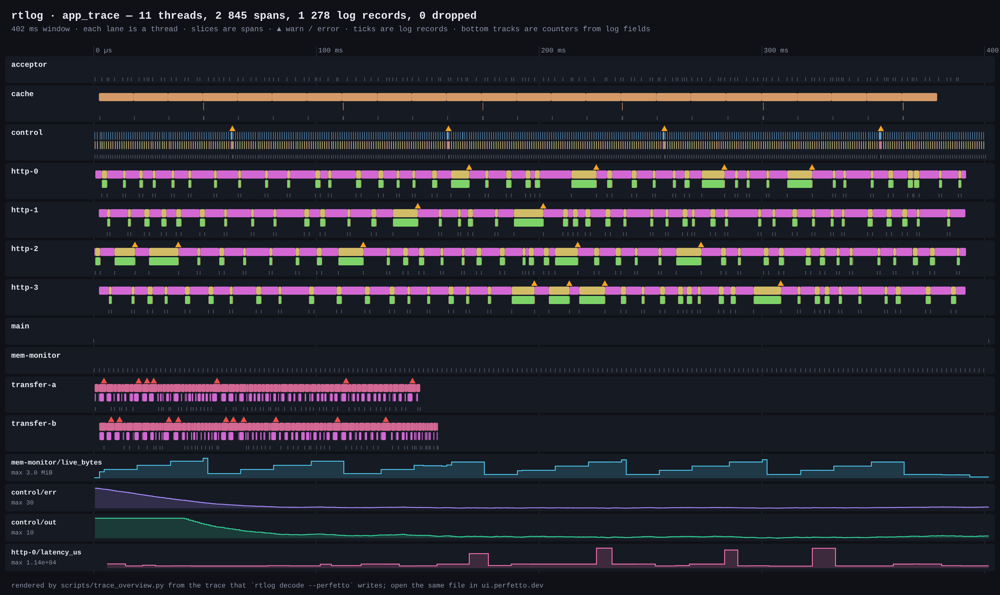
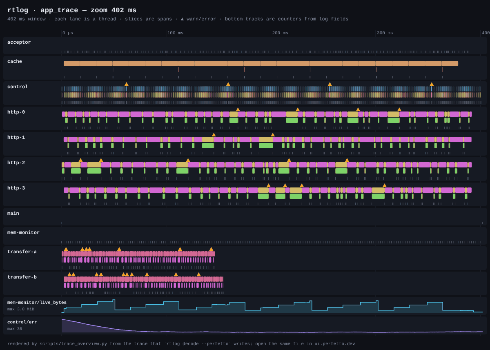
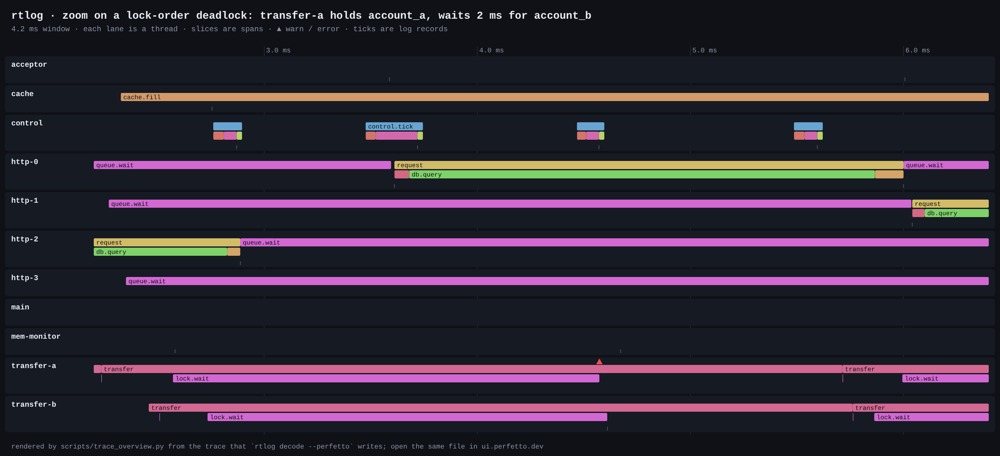
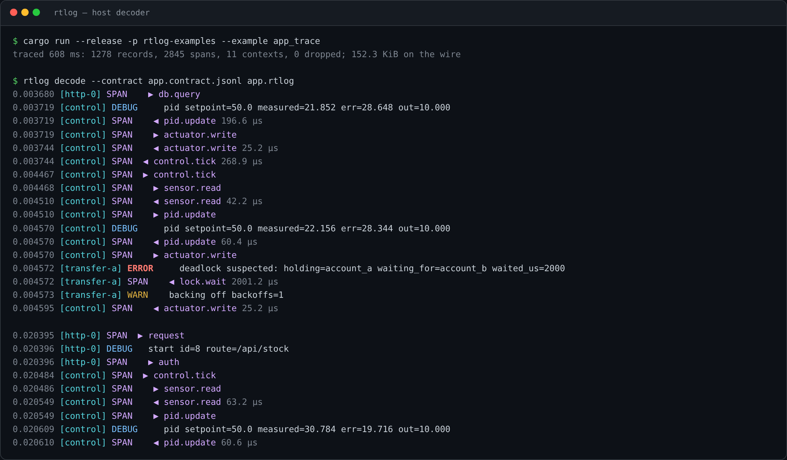
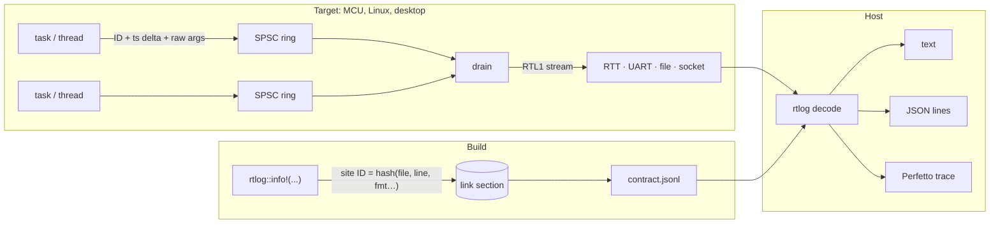

# rtlog

**Deferred logging and tracing for real-time code, from Cortex-M to Linux and desktop.**
A log call writes a few raw bytes into the calling thread's own lock-free ring: no formatting, no allocation, no lock, no syscall. Format strings stay out of the stream, and the host decoder turns it back into text, JSON lines or a [Perfetto](https://ui.perfetto.dev) trace.

[](https://github.com/NieWil/rtlog/actions/workflows/ci.yml)




*The [`app_trace`](examples/app_trace.rs) example: a 1 kHz control loop, an HTTP worker pool, two threads that deadlock on lock order, a cache and a heap monitor. Captured by rtlog, exported with `rtlog decode --perfetto`, drawn by [`scripts/trace_overview.py`](scripts/trace_overview.py). The same file opens in ui.perfetto.dev.*

## Why

| | rtlog | Text logging (`log`, `tracing-subscriber`, `printf`) |
| --- | --- | --- |
| Cost of a log call (W1, 2 × `u32`, GitHub runner) | **21.6 ns** p50 | 67.5 ns to format a timestamped line into a buffer |
| Cost of a disabled call | **0.4 ns** | similar |
| Bytes per W1 record | **18 B** on the wire | 33 B of text |
| Blocking, locks, allocation on the log path | **none** | formatter, global lock or writer |
| Format strings in the stream | **none** (contract file on the host) | all of them |
| Same call site on MCU and desktop | **yes** (`no_std` core) | rarely |

The numbers come from the [`timing` job](https://github.com/NieWil/rtlog/actions/workflows/ci.yml); each CI run republishes them.

## Follow an application down to the microsecond

Spans give each thread a nested timeline. Log fields named `key={}` become counter tracks. Warnings and errors are markers on the thread that raised them. Zooming from the whole run down to one deadlock:



At 4 ms the cause is plain. `transfer-a` holds `account_a` and waits for `account_b`, while `transfer-b` holds `account_b` and waits for `account_a`. The watchdog in `lock.wait` reports it after 2 ms and backs off, and the other thread proceeds:



The same capture in a terminal, with spans and their durations:



## Quick start

```rust
// Anywhere in your code (std): same shape as println!, every argument is typed.
rtlog::info!("pid out={:.3} err={}", out, err);

fn handle(req: &Request) {
    let _span = rtlog::span!("request");          // closes when dropped
    rtlog::debug!("start id={} route={}", req.id, req.route);
}

// Once at startup: the contract (all format strings) and an opt-in drain thread.
rtlog::contract::write("app.contract.jsonl")?;
let file = std::fs::File::create("app.rtlog")?;
let drain = rtlog::spawn_drain(rtlog::IoTransport(file), std::time::Duration::from_millis(1));
```

```sh
rtlog decode --contract app.contract.jsonl app.rtlog                 # coloured text
rtlog decode --contract app.contract.jsonl --json app.rtlog          # JSON lines
rtlog decode --contract app.contract.jsonl --perfetto -o app.json app.rtlog
# then open app.json in https://ui.perfetto.dev (or chrome://tracing, or Speedscope)
```

On `no_std`, each task owns a static ring and logs through its producer. An idle hook or DMA callback drains the rings:

```rust
static MOTOR: rtlog::Ring<1024> = rtlog::Ring::new();
let (mut p, mut c) = MOTOR.split(1).unwrap();
rtlog::warn!(to: &mut p, "temp={}", 81u8);
let s = rtlog::span!(to: &mut p, "pid.update");
p.span_exit(s);
```

Try it:

```sh
cargo run --release -p rtlog-examples --example app_trace   # writes target/app_trace/*
cargo run -p rtlog-examples --example static_rings          # the no_std API on the host
```

## How it works



- **One single-producer ring per thread or task.** No CAS, no spin, nothing shared between producers. A full ring drops the new frame and counts it, and the host sees every drop.
- **The drain is the only consumer** and the only place that can block. On `std` it is an opt-in thread; on an MCU, call it from the idle hook.
- **The contract** holds every format string and is keyed by a hash in the stream header, so a capture decodes only against the build that produced it.

The full design is in the [specification](docs/spec.md). What v0.1 builds, and where it differs from the spec, is in [implementation notes](docs/implementation.md).

## How it is verified

| Check | What it shows | CI job |
| --- | --- | --- |
| Unit, integration and doc tests (Linux, macOS, Windows) | encoding, rings, drain, decoder, CLI, spans, Perfetto export | `test` |
| Conformance vector + corruption sweep (every truncation, 20 000 random mutations) | the decoder never panics on untrusted input | `test` |
| Drain re-entrancy test | a transport may log or read stats while the drain runs, with no deadlock | `test` |
| Soak test, 2 minutes, thousands of threads started and retired | received + reported drops = sent, per thread; time never goes backwards; RSS stays flat | `soak` |
| Miri | no undefined behaviour in the unsafe ring and writer code, including cross-thread | `miri` |
| ThreadSanitizer | no data races in the rings, drain and thread registry | `sanitizer (thread)` |
| AddressSanitizer + LeakSanitizer | no memory errors or leaks | `sanitizer (address)` |
| `thumbv7em-none-eabihf` build | the core is `no_std` | `no_std` |
| Line coverage (`cargo llvm-cov`) | about 92 % at the last local measurement; each run's figure is on its job page | `coverage` |
| Timing report and Criterion benches | the numbers in the table above | `timing`, `benchmarks` |

## Crates

| Crate | Contents |
| --- | --- |
| [`crates/rtlog-core`](crates/rtlog-core) (lib `rtlog`) | Macros, spans, `Log` trait, SPSC rings, CPU-counter clock, drain, contract writer. `no_std`; `std` feature on by default. |
| [`crates/rtlog-decode`](crates/rtlog-decode) | Contract loader, streaming and whole-capture decoder, text / JSON / Perfetto output, `rtlog` CLI. |
| [`examples`](examples) | `app_trace`, `basic`, `static_rings`, `timing`. |

## Development

```sh
cargo test --workspace
RTLOG_SOAK_SECS=60 cargo test --release -p rtlog-decode --test soak -- --ignored --nocapture
cargo +nightly miri test -p rtlog-core --lib -- ring:: varint:: arg::
cargo run --release -p rtlog-examples --example timing
python3 scripts/trace_overview.py target/app_trace/app.perfetto.json overview.svg --from-ms 2 --to-ms 6
```

## Status

v0.1 preview: the core, the decoder and the Perfetto export work and are tested. Before 1.0:

- Strip format strings from shipped binaries (`cargo rtlog contract` / `verify`). Today they remain in the binary.
- Bring the call cost down to the spec's ≤ 15 ns target.
- `derive(Log)`, interned strings, resync frames, compression, AEAD, crash log, and `log` / `tracing` / `defmt` bridges.

**Licence:** not chosen yet. The spec proposes MIT / Apache-2.0 dual licensing.
