# rtlog

**Fast, tiny, structured logging and tracing for real-time code, from microcontrollers to multi-core servers.**

One wire format and one decoder for Cortex-M and RISC-V firmware (bare metal or Zephyr) and for programs on Linux, macOS and Windows, in Rust, C and C++.

You write `println!`-style log lines. The device writes a few binary bytes into a lock-free ring: no formatting, no allocation, no lock. You read text, JSON or a [Perfetto](https://ui.perfetto.dev) timeline on the host, or send the records to syslog, the systemd journal or OpenTelemetry.

[](https://github.com/NieWil/rtlog/actions/workflows/ci.yml)
[](https://codecov.io/gh/NieWil/rtlog)
[](https://crates.io/crates/rtlog)
[](https://docs.rs/rtlog)




## Why

- **Cheap on the device.** A log call takes 36 cycles (11 ns) on x86-64 and 46 on arm64, 6–8× less than formatting the line. On Cortex-M4F, 10 messages take 3.3 KB of flash against 18.3 KB with `core::fmt`, and 0.7 KB less once the [format strings are stripped](docs/strip.md) from the image. [Numbers →](docs/performance.md)
- **Never in the way.** Each thread or task owns its ring. A full ring drops and counts; it never blocks an ISR or a control loop.
- **More than text.** Spans, typed fields and per-thread timelines export straight to Perfetto. [See a real app traced →](docs/use-cases/perfetto.md)
- **One format everywhere.** Rust (`no_std` and `std`), C, C++ and Zephyr all write the same stream and use the same decoder.
- **Scales with the machine.** A 1 KiB ring on a microcontroller; one ring per thread on a server, so cores do not contend for a log lock.

## Where it runs

| Target | Languages | What CI does on every pull request |
| --- | --- | --- |
| Microcontrollers, bare metal: Cortex-M3, M4F, M7, M33; RV32IMAC | Rust (`no_std`), C, C++ | Builds the library for the four targets; measures flash and RAM on Cortex-M4F |
| Zephyr RTOS | C, C++ (module with Kconfig) | Builds the sample, runs it on an emulated Cortex-M3 (QEMU) and decodes its UART output |
| Linux: x86-64, x86, arm64, ARMv7, RISC-V 64 | Rust, C, C++ | Runs the tests natively and under QEMU; C and C++ end to end with GCC and Clang |
| macOS | Rust, C, C++ | Runs the tests; C and C++ end to end with Apple Clang |
| Windows | Rust, C, C++ (MinGW-w64, or Clang for the MSVC ABI) | Runs the tests; C and C++ end to end |

Any thread count works on the hosted systems: each thread gets its own ring on its first log call, and one drain thread serves them all. [Platform details →](docs/reference.md#cargo-features-and-platforms)

## Try it

`cargo add rtlog`, then:

```rust
use std::{fs::File, io::BufWriter, time::Duration};

fn main() -> Result<(), Box<dyn std::error::Error>> {
    // The format strings, written once; the decoder needs them.
    rtlog::contract::write("app.contract.jsonl")?;
    // A background thread moves frames from the rings to a file.
    let file = BufWriter::new(File::create("app.rtlog")?);
    let drain = rtlog::spawn_drain(rtlog::IoTransport(file), Duration::from_millis(10));

    for rpm in [1200u32, 1450, 1710] {
        rtlog::info!("motor speed={} rpm", rpm);
    }
    rtlog::warn!("temperature={} C", 81.5f32);

    // Flush what is still in the rings before exiting.
    let mut out = drain.stop();
    rtlog::Transport::flush(&mut out);
    Ok(())
}
```

Run it, then decode the capture with the CLI (`cargo install rtlog-decode`):

```text
$ rtlog decode --contract app.contract.jsonl app.rtlog
0.000000 [main] INFO  motor speed=1200 rpm
0.000002 [main] INFO  motor speed=1450 rpm
0.000002 [main] INFO  motor speed=1710 rpm
0.000002 [main] WARN  temperature=81.5 C
4 records, 0 spans, 1 contexts, 0 dropped
```

Without a drain, log calls fill the rings and nothing leaves the process. Two shortcuts while developing:

```rust
// Text on stdout while the program runs, like env_logger (cargo add rtlog-decode; RTLOG=debug).
let _log = rtlog_decode::stdout::init();
// Unix and Windows: keep the last records if the process panics or crashes.
rtlog::crash::install("crashes/")?;
```

Spans give each request or control-loop step a slice in [Perfetto](docs/use-cases/perfetto.md):

```rust
fn handle(req: &Request) {
    let _span = rtlog::span!("request");
    rtlog::debug!("route={} bytes={}", req.route, req.len);
}
```

The examples live in this repository; clone it first:

```sh
git clone https://github.com/NieWil/rtlog && cd rtlog
cargo run --release -p rtlog-examples --example perfetto_quickstart
# open target/quickstart.perfetto.json in https://ui.perfetto.dev
```

| Example | Shows |
| --- | --- |
| [`basic`](examples/basic.rs) | The flow above with several threads: drain to a file, contract, decode |
| [`perfetto_quickstart`](examples/perfetto_quickstart.rs) | Threads, spans and counters to a Perfetto trace in about 60 lines |
| [`app_trace`](examples/app_trace.rs) | A traced app: 1 kHz control loop, worker pool, a lock-order deadlock caught by a watchdog, heap counters |
| [`static_rings`](examples/static_rings.rs) | The `no_std` API: static rings, explicit producers, idle-loop drain |
| [`c/examples`](c/examples) | The same from C and C++ |
| [`stdout_mode`](examples/stdout_mode.rs) | Read logs as text on stdout, like `env_logger`, with binary log calls |
| [`timing`](examples/timing.rs) | Cost per call in ns and cycles on your machine |
| [`icount`](examples/icount.rs) | Instructions per call under callgrind, the number CI gates on |
| [`stripped`](examples/stripped.rs) | A program that ships without its format strings (`strip` feature) |

## How it works



Each call site gets an ID at build time; its format string goes into a contract. The program can write the contract itself (`rtlog::contract::write`, any OS), or the host reads it from the binary (`rtlog contract --elf`: ELF on Linux and firmware, Mach-O on macOS, PE on Windows). [Architecture →](docs/architecture.md)

The design has four stages, and each has one job:

| Stage | Where | What it does | What it never does |
| --- | --- | --- | --- |
| Log call | The program, on the calling thread | Writes the site ID, a timestamp and the raw arguments into the thread's ring | Format, allocate, lock, make a system call, wait |
| Drain | The program, on its own thread or in the idle loop | Sends the frames out: a file, stdout, a UART, RTT; a crash dump when the process dies | Slow down a log call: a full ring drops and counts |
| Contract | The build | Maps each site ID to its level, file, line and format string; read from the binary or written by the program | Reach the device in a [stripped build](docs/strip.md) |
| Decoder and exporters | The host (`rtlog` CLI, `rtlog-decode` library) | Joins frames and contract, then writes the output format | Run on the device |

Every output format is an exporter in the decoder, so adding one costs the program nothing:

| Exporter | State |
| --- | --- |
| Text, JSON lines, Perfetto timeline | Built (`rtlog decode --out text\|json\|perfetto`) |
| syslog (RFC 5424 lines) | Built (`rtlog decode --out syslog`, [guide](docs/syslog.md)) |
| OpenTelemetry logs (OTLP JSON lines) | Built (`rtlog decode --out otlp-json`, [guide](docs/opentelemetry.md)) |
| systemd journal (entries to a file, or sent to `systemd-journald`) | Built (`rtlog decode --out journald`, `--journald-socket`, [guide](docs/journald.md)) |
| Sending to a syslog daemon or over OTLP/HTTP, spans as OpenTelemetry traces | Planned ([roadmap, section 10](docs/roadmap.md#10-ecosystem-bridges)) |

## Guides

| | |
| --- | --- |
| [Perfetto tracing](docs/use-cases/perfetto.md) | Follow an application thread by thread, down to the microsecond |
| [When the process crashes](docs/crash.md) | Panics, segfaults, division by zero, abort: what is kept and what to do |
| [Embedded Rust](docs/embedded.md) | `no_std` setup, linker snippet, getting the contract from firmware |
| [C and C++](docs/c-cpp.md) | Header-only producer for Linux, macOS, Windows and bare metal: build, capture, decode |
| [Zephyr](docs/zephyr.md) | Module, Kconfig, transports |
| [Send logs to OpenTelemetry](docs/opentelemetry.md) | OTLP JSON log records from a capture, for an OpenTelemetry Collector |
| [Send logs to the systemd journal](docs/journald.md) | Journal entries from a capture: into the running journal, or as a file for `systemd-journal-remote` |
| [Send logs to syslog](docs/syslog.md) | RFC 5424 lines from a capture, for rsyslog, syslog-ng or a log collector |
| [Ship without the format strings](docs/strip.md) | Stripped builds: a smaller image with no log text in it, and `rtlog verify` as a release gate |
| [Configuration and CLI](docs/reference.md) | Levels, environment variables, features, every `rtlog` command and option, the JSON output |
| [Performance and size](docs/performance.md) | Cycles per call, flash and RAM, measuring on your board |
| [Results from users' boards](results/README.md) | Timing reports from real hardware; [add yours](CONTRIBUTING.md#share-your-boards-results) |
| [Demo on your device](docs/demo.md) | Prebuilt per architecture: copy to a board, run one script, open the trace on your computer |
| [Specification](docs/spec.md) · [Roadmap](docs/roadmap.md) · [Implementation notes](docs/implementation.md) | What is built, what is planned, and where the code deviates |

## Get it

- **CLI** (`rtlog decode`, `rtlog contract`): prebuilt for Linux (x86-64, x86, arm64, ARMv7, ARMv6, RISC-V 64), macOS and Windows on the [releases page](https://github.com/NieWil/rtlog/releases). Or build it: `cargo install rtlog-decode`.
- **Debian / Ubuntu** (amd64, i386, arm64, armhf), from the releases page (since 0.2.5):

  ```sh
  sudo apt install ./rtlog_<version>-1_amd64.deb      # the rtlog command and its man page
  sudo apt install ./rtlog-dev_<version>-1_all.deb    # rtlog.h for C/C++, with pkg-config
  ```

- **Other Linux distributions**: no package in a distribution's own repository yet. The static CLI from the releases page runs on any of them; packages you can add as a repository (AUR, PPA, COPR, a Yocto layer) are [planned](docs/roadmap.md#12-adoption-a-representative-application-and-being-easy-to-find-and-try).
- **Rust**: `cargo add rtlog` (for bare metal: `cargo add rtlog --no-default-features`).
- **Demo**: `rtlog-demo-<version>-<target>` on the releases page runs the timing report and a traced app on any of those machines. [How →](docs/demo.md)
- **C / C++ / Zephyr**: the `rtlog-c` package on the releases page, or [`c/include/rtlog.h`](c/include/rtlog.h) and the [Zephyr module](docs/zephyr.md).

## Status

v0.2 preview. Every CI run tests Rust, C and C++ on Linux, macOS and Windows, Rust on arm64, ARMv7, RISC-V and x86 under QEMU, and the Zephyr module on an emulated Cortex-M3. Each run also includes a 2-minute soak test, Miri, and Thread and Address sanitizers. Not yet there: `derive(Log)`, the `log` / `tracing` / `defmt` bridges and per-module levels. [Roadmap →](docs/roadmap.md)

## Licence

Licensed under either of [Apache License, Version 2.0](LICENSE-APACHE) or [MIT licence](LICENSE-MIT), at your option.

Unless you explicitly state otherwise, any contribution intentionally submitted for inclusion in rtlog by you, as defined in the Apache-2.0 licence, shall be dual licensed as above, without any additional terms or conditions.
