# rtlog

**Fast, tiny, structured logging and tracing for real-time code, from Cortex-M to Linux.**

You write `println!`-style log lines. The device writes a few binary bytes into a lock-free ring: no formatting, no allocation, no lock. You read text, JSON or a [Perfetto](https://ui.perfetto.dev) timeline on the host.

[](https://github.com/NieWil/rtlog/actions/workflows/ci.yml)




## Why

- **Cheap on the device.** A log call takes about 15 ns (53 cycles) on x86-64, about 5× less than formatting the line. On Cortex-M4F, 10 messages take 3.1 KB of flash against 16.8 KB with `core::fmt`. [Numbers →](docs/performance.md)
- **Never in the way.** Each thread or task owns its ring. A full ring drops and counts; it never blocks an ISR or a control loop.
- **More than text.** Spans, typed fields and per-thread timelines export straight to Perfetto. [See a real app traced →](docs/use-cases/perfetto.md)
- **One format everywhere.** Rust (`no_std` and `std`), C, C++ and Zephyr all write the same stream and use the same decoder.

## Try it

```rust
rtlog::info!("motor speed={} rpm", rpm);

fn handle(req: &Request) {
    let _span = rtlog::span!("request");          // a slice in Perfetto
    rtlog::debug!("route={} bytes={}", req.route, req.len);
}
```

```sh
cargo run --release -p rtlog-examples --example perfetto_quickstart
# open target/quickstart.perfetto.json in https://ui.perfetto.dev
```

| Example | Shows |
| --- | --- |
| [`perfetto_quickstart`](examples/perfetto_quickstart.rs) | Threads, spans and counters to a Perfetto trace in 40 lines |
| [`app_trace`](examples/app_trace.rs) | A traced app: 1 kHz control loop, worker pool, a lock-order deadlock caught by a watchdog, heap counters |
| [`static_rings`](examples/static_rings.rs) | The `no_std` API: static rings, explicit producers, idle-loop drain |
| [`c/examples`](c/examples) | The same from C and C++ |
| [`timing`](examples/timing.rs) | Cost per call in ns and cycles on your machine |

## How it works



Each call site gets an ID at build time; its format string goes into a contract the host reads from the binary (`rtlog contract --elf`). [Architecture →](docs/architecture.md)

## Guides

| | |
| --- | --- |
| [Perfetto tracing](docs/use-cases/perfetto.md) | Follow an application thread by thread, down to the microsecond |
| [Embedded Rust](docs/embedded.md) | `no_std` setup, linker snippet, getting the contract from firmware |
| [C and C++](docs/c-cpp.md) | Header-only producer, build, capture, decode |
| [Zephyr](docs/zephyr.md) | Module, Kconfig, transports |
| [Performance and size](docs/performance.md) | Cycles per call, flash and RAM, measuring on your board |
| [Specification](docs/spec.md) · [Implementation notes](docs/implementation.md) | The full design, and where v0.1 stands |

## Get it

- **CLI** (`rtlog decode`, `rtlog contract`): prebuilt for Linux (x86-64, x86, arm64, ARMv7, ARMv6, RISC-V 64), macOS and Windows on the [releases page](https://github.com/NieWil/rtlog/releases), starting with the first tagged release. Or build it: `cargo install --git https://github.com/NieWil/rtlog rtlog-decode`.
- **Rust**: `rtlog-core = { git = "https://github.com/NieWil/rtlog" }`.
- **C / C++ / Zephyr**: the `rtlog-c` package on the releases page, or [`c/include/rtlog.h`](c/include/rtlog.h) and the [Zephyr module](docs/zephyr.md).

## Status

v0.1 preview. Every CI run tests it on Linux, macOS, Windows, and on arm64, ARMv7, RISC-V and x86 under QEMU. Each run also includes a 2-minute soak test, Miri, and Thread and Address sanitizers. Before 1.0: strip format strings from shipped binaries, reach the ≤ 50-cycle budget per call, and add `derive(Log)` and the `log` / `tracing` / `defmt` bridges.

## Licence

Licensed under either of [Apache License, Version 2.0](LICENSE-APACHE) or [MIT licence](LICENSE-MIT), at your option.

Unless you explicitly state otherwise, any contribution intentionally submitted for inclusion in rtlog by you, as defined in the Apache-2.0 licence, shall be dual licensed as above, without any additional terms or conditions.
