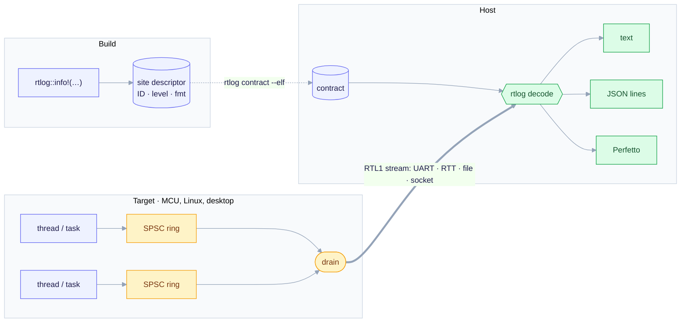
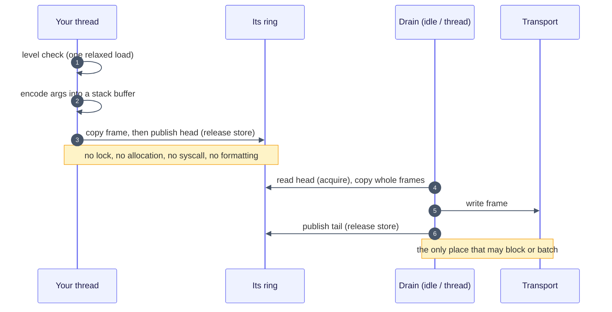

# How rtlog works

Three stages. At **build** time, each call site gets an ID and a descriptor. At **runtime**, each thread writes raw binary frames into its own ring. On the **host**, the decoder joins the stream with the contract.

## One log call

## The frame

| Field | Size | Content |
| --- | --- | --- |
| site ID | 4 B | from the contract: content hash (Rust) or descriptor index (C) |
| timestamp delta | varint, 1–10 B | ticks since this ring's previous frame |
| context | varint, 1–5 B | which thread / task / ISR |
| arguments | per argument: 1 B type tag + value | integers and floats raw little-endian; strings as length + bytes |

A W1 call (`info!("x={} y={}", u32, u32)`) is 18 bytes on the wire; the same line as text is 33. Control frames announce contexts, report drops and open and close spans. The full grammar, design decisions and threat model are in the [specification](spec.md); what v0.2 implements and where it differs is in the [implementation notes](implementation.md).

## Guarantees

- **Single producer, single consumer per ring.** There is no CAS and no spin. Producers never share a cache line with each other.
- **Lossy, never blocking.** A full ring drops the new frame and counts it. The drain reports the count, so the host sees every loss.
- **Untrusted input on the host.** The decoder bounds every length and allocation and stops cleanly at the first bad frame. A corruption sweep in CI checks this.
