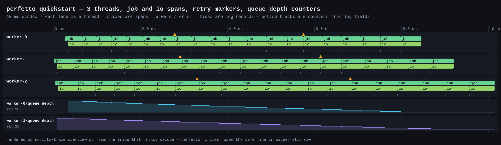
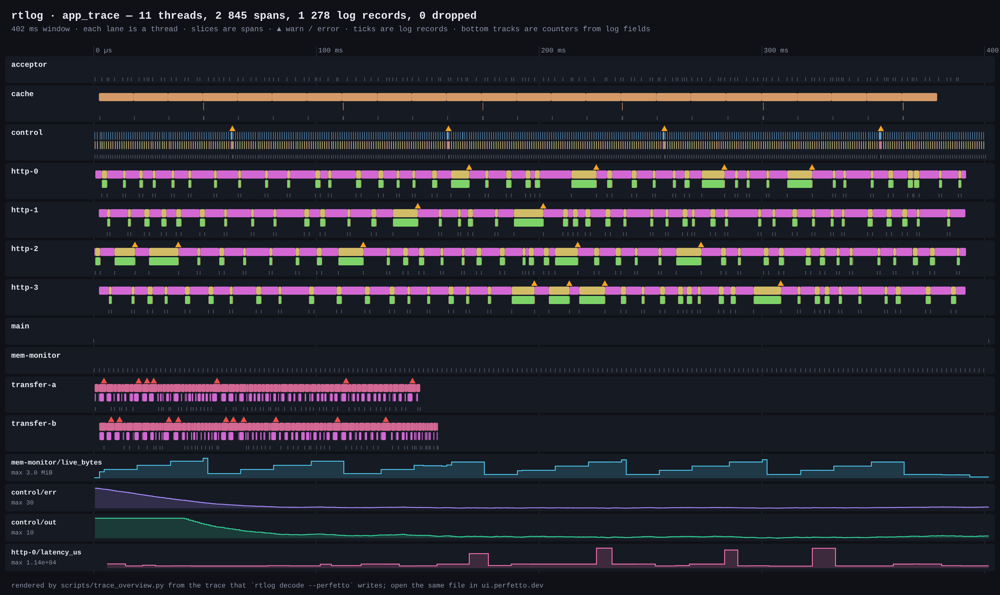
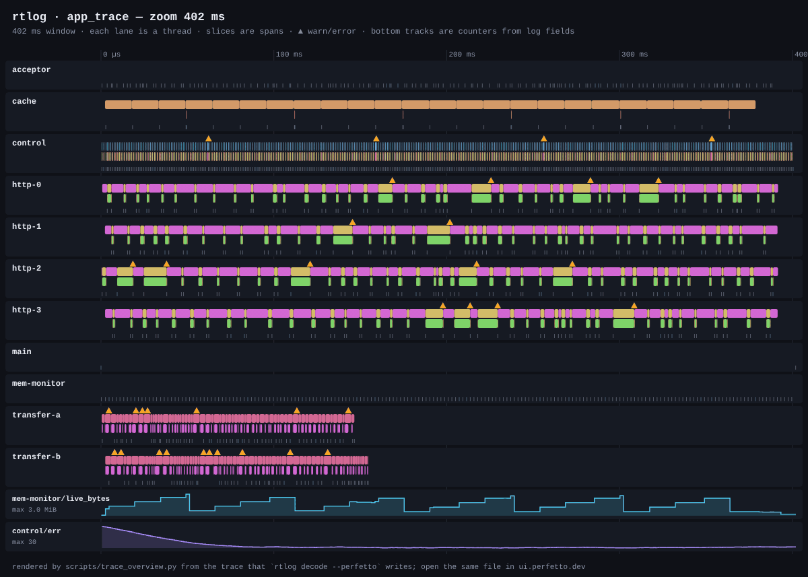
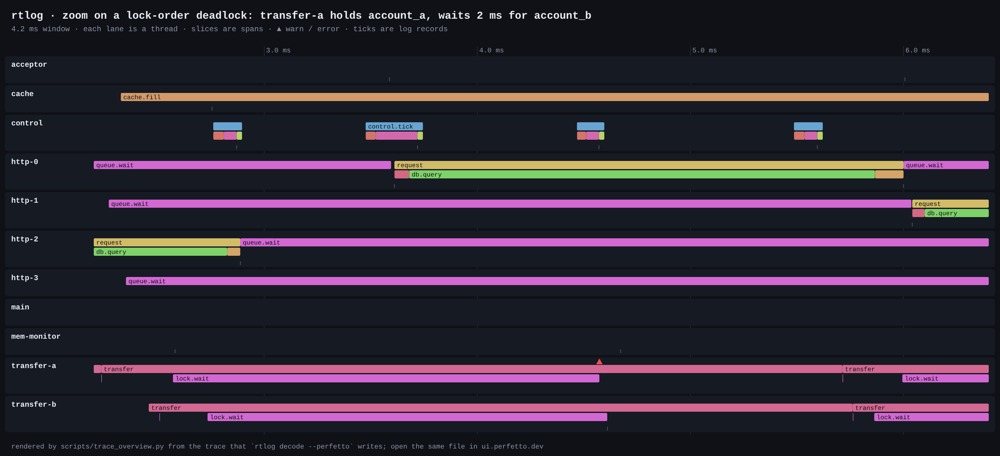

# See your application in Perfetto

rtlog captures are complete timelines: every thread, every span, every log record with its typed fields. `rtlog decode --perfetto` turns one into a trace that [Perfetto](https://ui.perfetto.dev) opens directly. So do `chrome://tracing` and [Speedscope](https://www.speedscope.app).

## In 40 lines

[`examples/perfetto_quickstart.rs`](../../examples/perfetto_quickstart.rs) runs three worker threads. Each job is a span with an `io` span inside, and every job logs its queue depth:

```rust
fn worker(id: u32) {
    for job in 0..20u32 {
        let _job = rtlog::span!("job");                            // a slice on this thread's track
        rtlog::info!("job id={} queue_depth={}", job, 20 - job);   // `queue_depth` becomes a counter
        let _io = rtlog::span!("io");
        /* ... */
    }
}
```

```sh
cargo run --release -p rtlog-examples --example perfetto_quickstart
# then drag target/quickstart.perfetto.json onto https://ui.perfetto.dev
```



## What maps to what

| In your code | In Perfetto |
| --- | --- |
| A thread (or task / ISR with its own ring) | A thread track, named by `set_context_name` or the thread name |
| `rtlog::span!("name")` | A slice; nested spans stack under their parent |
| `info!`, `warn!`, … | An instant event; its arguments are typed fields in the details panel |
| A numeric field written as `key={}` | A counter track named `thread/key` |
| A drop report | A `dropped N frames` marker and a `dropped` counter |

Timestamps come from the target's clock: the TSC or `CNTVCT_EL0` on desktop, DWT or the RTOS tick on an MCU. That makes slice widths real durations at sub-microsecond resolution.

## A realistic application

[`examples/app_trace.rs`](../../examples/app_trace.rs) simulates a small system for about half a second:

- a 1 kHz control loop with PID values and injected deadline misses;
- an HTTP worker pool;
- two threads that take two locks in opposite order, with a watchdog;
- a cache;
- a counting allocator, sampled into heap counters.

```sh
cargo run --release -p rtlog-examples --example app_trace
# writes target/app_trace/app.perfetto.json (+ text, JSON lines, the raw capture and its contract)
```



Zooming from the whole run down to one deadlock report:



At 4 ms the cause is visible. `transfer-a` holds `account_a` and waits for `account_b`, while `transfer-b` holds `account_b` and waits for `account_a`. The watchdog in `lock.wait` reports it after 2 ms and backs off, then the other thread proceeds:



The images on this page are drawn from the exported trace by [`scripts/trace_overview.py`](../../scripts/trace_overview.py), so they can be regenerated from any capture. Interactive exploration is in Perfetto. Every CI run uploads `app.perfetto.json` as the `app-trace-perfetto` artifact.

## From the command line

```sh
rtlog decode --contract app.contract.jsonl --perfetto -o app.json app.rtlog
python3 scripts/trace_overview.py app.json app.svg --from-ms 2 --to-ms 6   # a static picture of a window
```

C and C++ captures export the same way; see [C and C++](../c-cpp.md).
